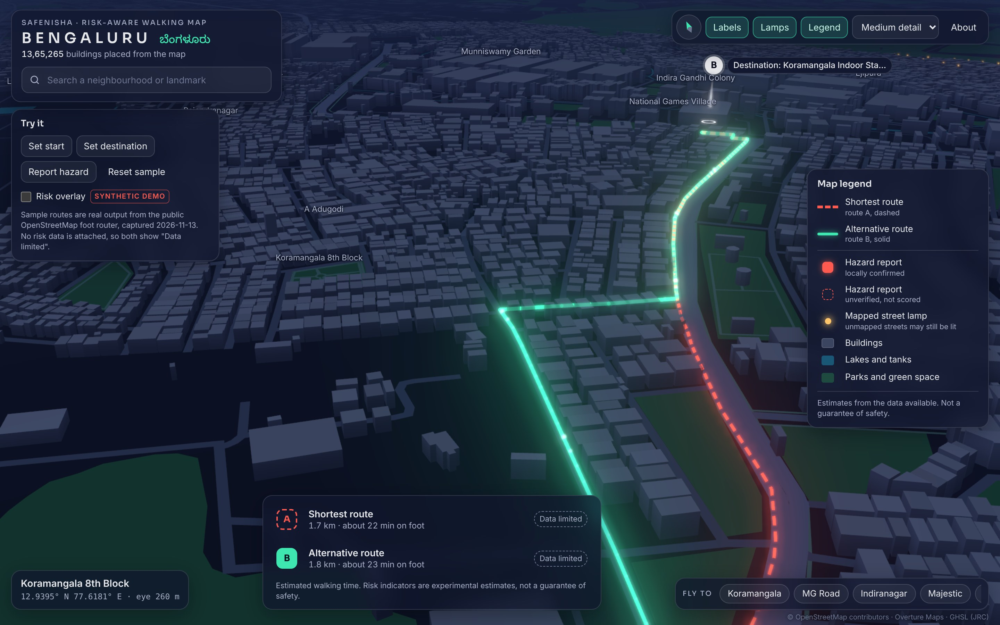
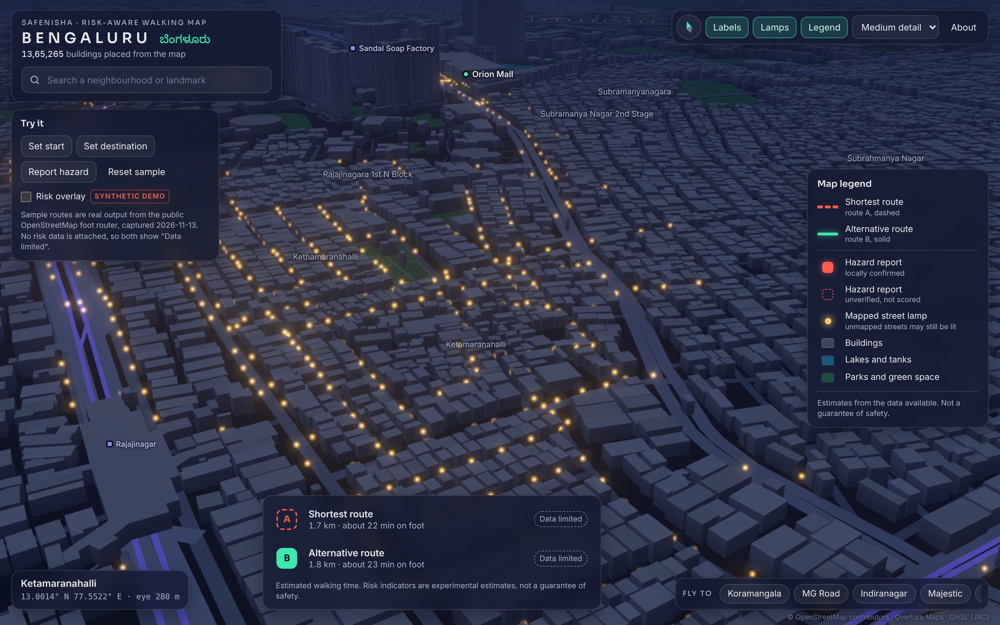
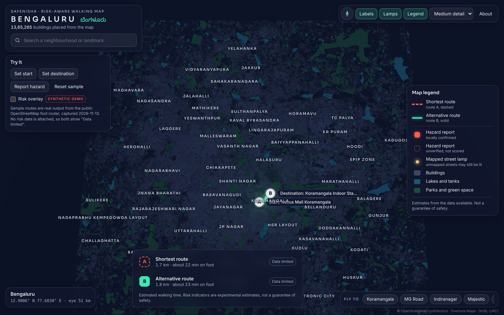
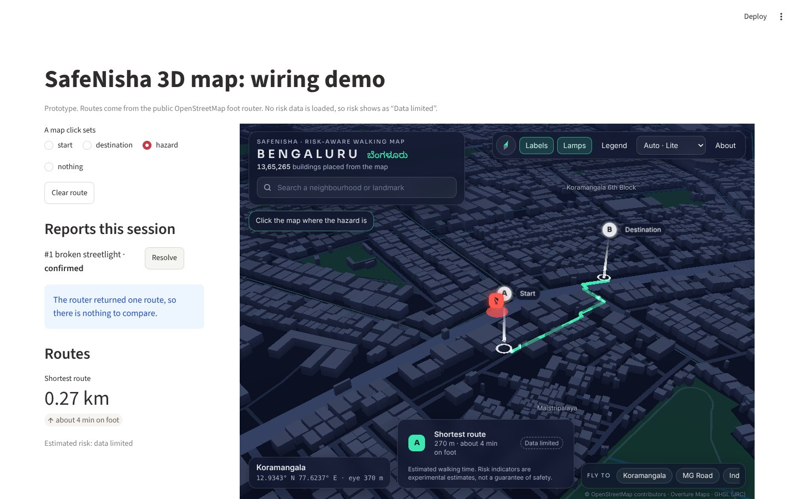

# SafeNisha 3D map

A 3D map of Bengaluru for the SafeNisha route view, built from open map data and
styled with the map colour frame: Dusk Navy `#0A0F1F`, Safe Teal `#3EE6B0`,
Caution Coral `#FF5A4F`.

It replaces the flat tile map only. It draws what the app gives it (routes,
endpoints, hazard reports, optional risk cells, the walker's position) and
reports map clicks back. **It never computes or guesses risk.** A route without
a `risk_indicator` is labelled "Data limited".

## What works

- Bengaluru in 3D on a 38 × 34 km grid: 13,65,265 building footprints, the road
  and footway network, rail and metro lines, lakes, parks, and 5,914 street
  lamps that are mapped in OpenStreetMap.
- Tiles stream in around the camera, so only the area being looked at is loaded.
- Routes: lower-risk / alternative route as a solid teal line with moving
  pulses, shortest route as a dashed coral line. They differ by line style and
  by A / B tags, not only by colour.
- Hazard reports: unverified (`new`) reports are a dashed outline, confirmed
  ones are solid coral, resolved ones are not drawn.
- Start / destination markers, the walker's position dot, optional coral
  risk columns.
- Click anywhere to get a latitude / longitude back (for start, destination or
  a hazard point).
- Place search over 1,900 neighbourhood, landmark, lake, park and station
  names, fly-to shortcuts, compass, labels / lamps / legend toggles.
- Laptop and phone layouts (checked at 1440 × 900 and 390 × 844, no sideways
  scroll).
- Works without a build step and without a CDN: three.js is vendored.
- Tiles are processed on background threads, distant small buildings are
  skipped, and the map only redraws when something moves. See
  [Performance](#performance).

## Screenshots

| | |
|---|---|
|  Route comparison, laptop |  Mapped street lamps and the metro line |
|  Whole city |  Inside Streamlit (`demo_app.py`) |

Phone layout: [docs/screenshots/mobile.jpg](docs/screenshots/mobile.jpg)

## Run it

Standalone preview (sample routes included):

```bash
cd map3d/frontend
python -m http.server 8000
```

Then open <http://localhost:8000>. Opening `index.html` as a file does not
work; browsers block module scripts and data files on `file://`.

Streamlit wiring demo:

```bash
python -m pip install -r requirements.txt
python -m streamlit run demo_app.py
```

Tests:

```bash
python -m pip install pytest
python -m pytest tests
```

```bash
node --test tests/test_tiles.mjs
```

## Put it in SafeNisha

Copy the `map3d/` folder to the repository root (next to `app.py`). It is about
24 MB, almost all of it map tiles; a visitor downloads only the tiles near
where they look (about 1 MB for a typical first view).

```python
from map3d import safenisha_map

event = safenisha_map(
    start=(12.9346, 77.6113),
    destination=(12.9435, 77.6228),
    route_result=route_result,         # Member 1: {"shortest": {...}, "lower_risk": {...}}
    hazards=get_active_hazards(),      # Member 4: hazard dicts, unchanged
    pick_mode=pick_mode,               # "start", "destination", "hazard" or None
    key="map",
)

if event and event["type"] == "click" and event["mode"] == "hazard":
    add_hazard(event["lat"], event["lon"], hazard_type, description)
```

`route_result` is the existing contract plus the route geometry:

```python
route_result = {
    "shortest":   {"distance_m": 850,  "risk_indicator": 0.42, "coords": [(lat, lon), ...]},
    "lower_risk": {"distance_m": 1100, "risk_indicator": 0.25, "coords": [(lat, lon), ...]},
}
```

- `coords` are `(lat, lon)` pairs. The public router returns `[lon, lat]`;
  `map3d.routes_from_osrm(response)` converts a router response for you.
- `risk_indicator=None` shows "Data limited". Do not pass `0` for "unknown".
- Optional per route: `duration_s`, `label`, `id`.
- If both entries follow the same path, one line is drawn.

Other arguments: `routes=[...]` (instead of `route_result`), `user_location`,
`risk_cells`, `selected_route`, `fit="none"`, `fly_to={...}`,
`hud="minimal" | "full" | "none"`, `show_route_card`, `labels`, `lamps`,
`legend`, `stats`, `quality`, `height`. See the docstring in `map3d/__init__.py`.

Events returned (each one once):

| `type` | Fields | When |
|---|---|---|
| `click` | `lat`, `lon`, `mode`, `inside` | The map was clicked. `mode` is the current `pick_mode`. `inside` is false outside the mapped area. |
| `hazard_click` | `id` | A hazard marker was clicked. |
| `route_select` | `id` (or `None`) | A route row in the card was clicked. |
| `benchmark` | `result` | The benchmark in the map's About panel finished. |

Not using Streamlit? Put `map3d/frontend/` in an iframe, post
`{type: "safenisha:set", state: {...}}` to it with the same field names, and
listen for `{type: "safenisha:event", event}`.

## Files

```text
map3d/
├── __init__.py            Streamlit component wrapper + helpers
└── frontend/
    ├── index.html         page shell and HUD
    ├── map.css            styles and colour tokens
    ├── app.js             HUD logic, demo mode, host bridge
    ├── engine.js          three.js city renderer
    ├── tiles.js           tile download, unpacking and meshing
    ├── tile-worker.js     background thread that runs tiles.js
    ├── perf-tools.js      live stats readout and benchmark
    ├── vendor/            three.js 0.170 and earcut (MIT / ISC)
    └── data/              baked map tiles (323 files), manifest, sample routes
demo_app.py                wiring example
tools/build_data.py        rebuilds data/ from the open sources
tools/fetch_sample_routes.py
tests/test_map3d.py        Python helpers and baked data
tests/test_tiles.mjs       tile builder (node --test)
```

## Performance

### Measure it on your own device

Frame rate depends on the graphics chip, so measure it on the laptop or phone
you will demo on:

- **Benchmark:** open the map, then About → **Run 24-second benchmark**, or
  open `index.html?bench=1`. It flies a fixed route (street level in
  Koramangala, out to the district, then the whole city) while tiles stream in.
  It reports average frame rate, the slowest 1% of frames, page freezes, tile
  processing time, triangles drawn and the GPU name. **Copy results** gives
  you the numbers as text.
- **Live readout:** About → **Show live stats**, `index.html?stats=1`, or
  `safenisha_map(..., stats=True)` in Streamlit.

Rough guide: 50 fps or more is smooth, 30 to 50 is usable, below 30 choose
Low or Lite detail. On "Auto detail" the map steps down by itself when frames
are slow.

### What was measured here

Measured in Chromium on a 4-thread 2.3 GHz Intel Xeon, comparable to a
mid-range laptop CPU. This machine has **no graphics card** (software
rendering), so its frame rates say nothing about real devices and are not
quoted. Load time, processing time and the amount of geometry do not depend on
the graphics card and are real measurements. "Before" is the previous version
of this map; numbers vary by about ±0.3 s between runs.

| | Before | After |
|---|---:|---:|
| First buildings on screen, 20 Mbps 4G (40 ms latency) | 3.9 s | 1.0 s |
| Whole first view built, 20 Mbps 4G | 4.5 s | 2.2 s |
| First buildings on screen, 6 Mbps (120 ms latency) | 11.6 s | 3.3 s |
| Whole first view built, 6 Mbps | 13.0 s | 4.4 s |
| Downloaded before the first view is complete | 9.5 MB | 2.7 MB |
| Main-thread time per tile (median / worst) | 3.8 / 16 ms | 0.1 / 1.5 ms |
| Triangles drawn, street view (650 m) | 0.94 M | 0.32 M |
| Triangles drawn, neighbourhood view (1.7 km) | 1.35 M | 0.68 M |
| Triangles drawn, district view (4.5 km) | 2.58 M | 0.94 M |
| Draw calls, district view | 592 | 273 |

Processing rate (download, unpack and mesh, in an otherwise idle page):

| | |
|---|---|
| One thread | 4.1 ms per tile median, 35 ms worst; 0.73 M buildings/s |
| 3 background threads | whole city (323 tiles, 13.65 lakh buildings) in 0.93 s; 1.47 M buildings/s |

A typical view needs 15 to 30 tiles, so about 50 to 90 ms of background work
on this CPU. Phones are usually 3 to 5 times slower, still off the main thread.

At street level the picture is pixel-identical to before. At the district view
under 2% of pixels differ, from the smallest far-away buildings.

### What makes it fast

- **No waiting on the background picture.** Buildings load first. The
  far-view picture comes as a 0.4 MB version right away and a sharper 1.7 MB
  one after the first view is built (it was one 6.5 MB file before).
- **Background threads.** Tiles are downloaded, unpacked and turned into 3D
  meshes in Web Workers (up to 4), so panning and zooming never wait on them.
  If a browser cannot start workers, the same code runs on the main thread.
- **Distance-based detail.** Buildings in each 500 m block are stored largest
  first; far away the map draws only the ones big enough to see (at least 2
  CSS pixels on Medium, 3 on Low, 4 on Lite). Blocks wholly outside the detail
  radius are skipped: their buildings are already in the ground picture.
- **Redraws only when needed.** Nothing moving means no redraws. With a route
  shown, its moving pulses redraw at 30 frames a second instead of 60.
- **Auto detail.** Steps down High → Medium → Low → Lite if frames stay slow.
- **Cheaper clicks.** Clicking tests only visible buildings between the camera
  and the ground.

### If it is slow on the demo device

- Pick **Low** or **Lite** in the detail menu (`quality="low"` in Streamlit).
  Lite has no glow, which is the most expensive effect.
- A smaller map (`height=` in Streamlit) means fewer pixels to draw.
- Close other heavy tabs; browsers share one graphics chip.


## What is real, what is generated

Real, from open data:

- Building footprints, roads, footways, rail, metro, lakes, parks, street
  lamps, station and place names: Overture Maps release 2026-10-21.0, which
  redistributes OpenStreetMap, Google Open Buildings and Microsoft ML Buildings.
- Building heights, in this order: mapped height (1,295 buildings), mapped
  floor count × 3.2 m (12,060), otherwise the average building height published
  for the surrounding ~90 m cell in GHSL GHS-BUILT-H R2023A, epoch 2018
  (13,41,036), otherwise a 4 m default (10,874).
- The sample routes in the standalone demo are untouched output from the public
  OpenStreetMap foot router, captured 2026-11-13.

Generated, for looks only:

- A ±15% height variation between neighbouring buildings where only the area
  estimate exists, so a block is not one flat slab.
- Shading, haze, glow, and the pulses that travel along a route.
- The "Risk overlay, synthetic demo" checkbox in the standalone page draws
  random columns that change on every toggle and shows a banner saying so. It
  exists only to show what the overlay looks like. It is not in the Streamlit
  component unless you pass `risk_cells`.

## Known limits

- **Heights are mostly area averages from 2018.** Individual towers are often
  too low and recent buildings can be missing. This is a visual model, not a
  surveyed digital twin.
- **Street lamps are only the ones volunteers have mapped.** A street with no
  lamp on the map is not known to be unlit. Do not feed these into the
  lighting-deficiency factor as if absence meant darkness.
- Flyovers, underpasses and metro viaducts are drawn flat on the ground.
- No terrain; Bengaluru is drawn flat.
- The map does not route. It has no turn-by-turn navigation and no background
  tracking; `user_location` only moves a dot when the app passes a new value.
- Clicks return the point under the cursor. They are not snapped to a road.
- In the standalone demo, setting your own start and destination asks the
  public walking router from the browser. That request worked from the command
  line here but was refused in the automated test browser, so that one path is
  untested in a browser; when it fails the page says so and draws no route. The
  Streamlit demo fetches routes in Python and was tested end to end.
- Tested in Chromium with software rendering only. Not yet tried on a real
  phone or a laptop graphics chip; run the benchmark there before the demo.
  "Auto detail" steps down to "Lite" (no glow) if frames are slow.
- Needs a browser from 2023 or later (WebGL 2 and `DecompressionStream`).

## Rebuild the data

```bash
python -m pip install -r tools/requirements-build.txt
python tools/build_data.py --cache .cache --out map3d/frontend/data
python tools/fetch_sample_routes.py
```

Downloads about 350 MB into `.cache/` and takes under a minute after that. To
cover a different area or size, change `ORIGIN_LAT`, `ORIGIN_LON` and `EXTENT`
at the top of `tools/build_data.py`. Outside the current GHSL tile (10° square
around Bengaluru) also change `GHSL_TILE`.

## Attribution

The map shows "© OpenStreetMap contributors · Overture Maps · GHSL (JRC)" and
lists full sources under About. Keep that visible: the OpenStreetMap licence
(ODbL) requires it.
